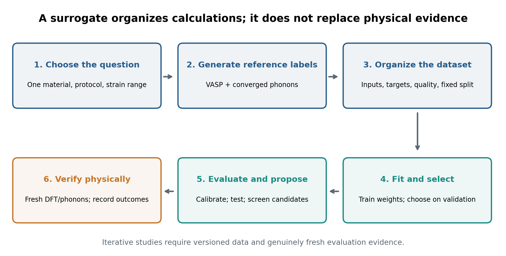
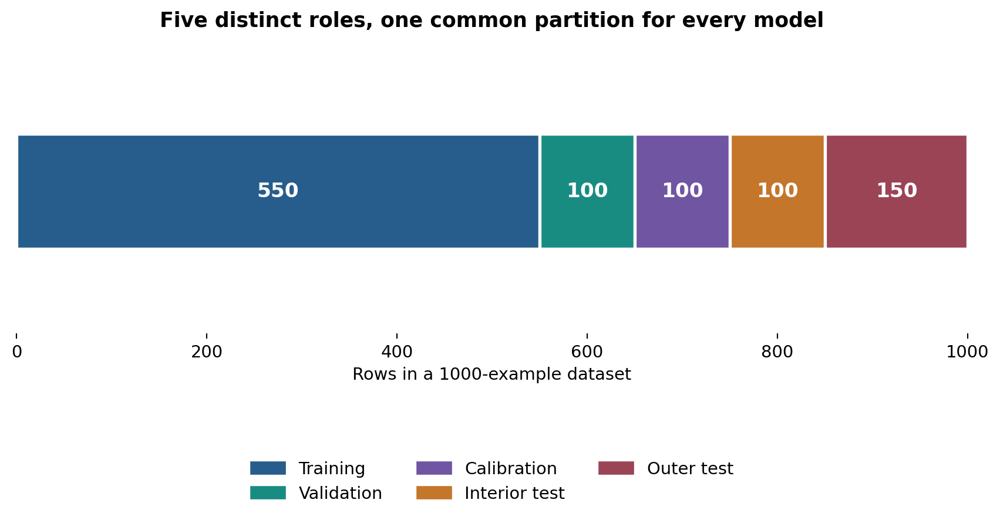
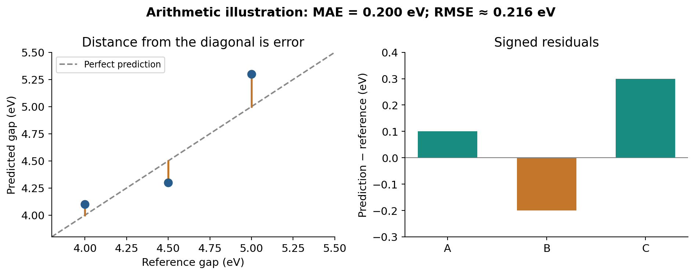
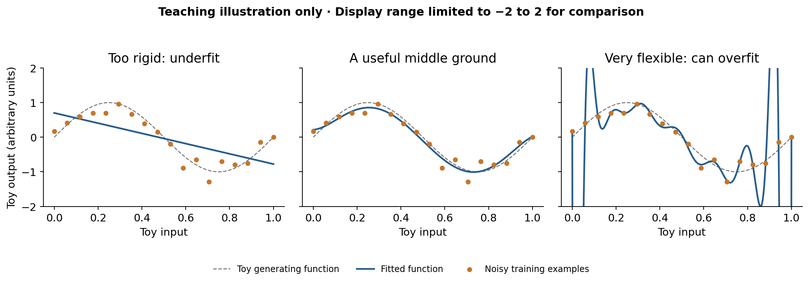
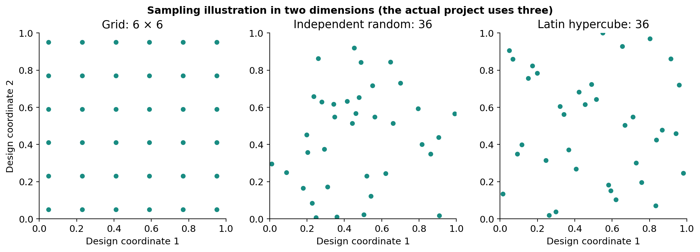

# How to use this book

This book assumes you have never studied machine learning (ML). You do not need to know neural networks, programming terminology, or statistics before starting. You do need patience with new words: each is introduced before it is used. Mathematical formulas are explained with numbers, and the practical sections use the project already written for you.

Your research question is: **can we learn the relationship between strain and material properties from a limited number of first-principles calculations, and then use that relationship to propose useful new calculations?** The word *learn* here means fitting a mathematical function to examples. It does not mean that a computer understands a material as a physicist does.

This edition describes the project implementation introduced in Git commit `7fe4f83`. The reference is Ma et al., *Transformer-based prediction of two-dimensional material electronic properties under elastic strain engineering*, arXiv:2603.20141v1. The authors studied monolayer h-BN. Your material has not been selected. Our software implements the general workflow for one material at a time; it does not contain a trained model for every material.

## What is already finished, and what is not

The code, synthetic demonstration, automated software tests, and instructions exist in the GitHub repository `samantadt/ML_strain`. The earlier project validation recorded 15 passing tests. Synthetic means *invented for testing the program*, not measured or calculated with VASP. No real material accuracy has been established. No VASP calculation has been executed on your university cluster by this project.

You can present a completed **software workflow** now. A completed **scientific study** needs a chosen material, converged first-principles data, and fresh validation calculations. Keep those two achievements separate when speaking to your supervisor.

## A reading plan

Read Chapters 2–8 first to understand the problem, data, training and evaluation. Then do the first practical exercise. Read the model and uncertainty chapters before making scientific choices. Use the later calculation and presentation chapters when planning the actual study. The glossary and command reference are intended for repeated use.

Do not try to memorize every equation. After each chapter, answer its checkpoint in your own words. Being able to explain why a step exists matters more than remembering a command.

## Three different kinds of example

Throughout this book:

- **Arithmetic example** means small invented numbers that teach a calculation.
- **Synthetic project result** means the actual program was run, but its labels came from an invented function.
- **Real material result** means a physical calculation or measurement with documented provenance. There are no such results supplied by this book.

A value appearing in an arithmetic example must never become a row of your real DFT dataset.

# What machine learning will do for your research

## The expensive function

Imagine one relaxed 2D crystal. You stretch it in the x direction, stretch it in the y direction, and shear it. For each deformation you want to know its bandgap and whether its lattice is dynamically stable.

A first-principles calculation is one way of evaluating a function:

$$
(\varepsilon_{xx},\varepsilon_{yy},\varepsilon_{xy})
\longrightarrow
(E_g,\Delta E,\text{directness},\text{stability}).
$$

DFT and phonon calculations supply examples of this mapping. They may be expensive, particularly because a phonon calculation needs forces for several displaced supercells. A surrogate model is a cheaper approximation to this function. Once trained, it can estimate outputs for many candidate strains quickly.

The surrogate does not remove the need for DFT. DFT supplies the learning examples and checks the final proposals. A good workflow uses expensive calculations where they add the most information, and cheap predictions to organize the search.

{width=95%}

## Training is different from prediction

During **training**, the program has strain inputs and known answers. It adjusts a model so its outputs better match those answers. During **prediction**, the fitted model receives a strain input and returns an estimate without seeing that input's answer.

For example, if VASP gives a particular strain a gap of 4.30 eV, training can use that pair. After training, a different strain might receive a predicted gap of 4.25 eV. Until you run the new first-principles calculation, 4.25 eV remains a model estimate.

## Why one material at a time?

The same numerical strain can give different gaps in different materials. Three strain components do not identify the chemical composition, phase, substrate or electronic-structure method. A model whose only inputs are three strains has no way to distinguish h-BN from MoS2.

Consequently, this project trains a separate surrogate for each material, phase and numerical protocol. A future model that transfers across materials would need suitable material descriptors, a multi-material dataset, and a different validation design. That is a separate research problem.

## What counts as success?

Success is not simply obtaining a low number in a report. A useful model must beat a simple baseline, perform acceptably on unseen calculations, and be sufficiently accurate for your intended design decision. It should reveal where predictions are poorly supported. Fresh shortlisted designs should pass their own DFT and phonon checks.

**Checkpoint:** explain why a model that predicts quickly still needs new DFT calculations. Your answer should mention training labels and independent verification.

# The computer tools, explained from zero

## Repository, file and folder

A repository is a project folder with a history of changes managed by Git. GitHub stores a shared copy online. Your working folder contains editable files; a Git commit records a particular version; a push sends commits to GitHub. Saving a file in an editor does not, by itself, push it.

The project has folders named `src`, `tests`, `configs`, `examples`, `notebooks` and `docs`. A file extension tells you its usual purpose: `.py` is Python source code, `.csv` is a table, `.yaml` is settings, `.ipynb` is a notebook, `.md` is readable text documentation, and `.pdf` is a formatted document.

## Terminal, Python and notebook

A terminal accepts commands such as `python --version`. Python is the language that runs the program. A notebook combines text, Python cells and displayed results in one document. VS Code can edit source files and open a terminal; Jupyter can open notebooks.

There are two different places to type:

| Where you type | Example | Meaning |
|---|---|---|
| Terminal | `python -m strain2d --help` | Run the project's command interface |
| Python cell/file | `import pandas as pd` | Import a Python library |
| YAML settings file | `seed: 42` | Set an option for a future run |

Do not paste a terminal command into a normal Python cell unless you know the notebook's shell-command syntax. The notebook included with this project uses Python to invoke the commands safely for you.

## Environment and library

A library is reusable software, such as NumPy for arrays, pandas for tables, scikit-learn for classical ML, PyTorch for neural networks, ASE for atomic structures, or Phonopy for lattice vibrations.

A Python environment is a particular Python interpreter together with installed libraries. Two environments can have different versions. This explains a common problem: a library was installed successfully in one environment, but a notebook using another environment says it is missing.

A virtual environment isolates project dependencies. Activating it changes which `python` command your terminal uses. It does not change your physical data or submit a cluster job.

## Learn a few terminal conventions

`cd` changes the current folder. `ls` lists files in Linux. A path such as `configs/smoke.yaml` is relative to your current folder. A path beginning `/workspace/` is absolute. Quotation marks keep spaces and special characters together. A trailing backslash in the book's Linux commands means “continue this command on the next line.”

Do not type the example prompt symbol `$` if you see one in another tutorial. In this book, code blocks intended for the terminal omit that prompt.

## What you should not edit yet

First run the demonstration without changing source files. Once it works, change a copy of a configuration file. Edit model code only when you can explain what behavior you are changing and how you will verify it.

**Checkpoint:** if `import torch` works in your terminal but not your notebook, what should you check first? Check which interpreter/kernel each uses.

# Your dataset: rows, inputs and answers

## One row represents one configuration

A dataset is a collection of examples. Here, one row normally represents one strained configuration of one material under one numerical protocol. Its input columns describe the strain; its target columns contain calculated properties.

We usually write the inputs as $X$ and the answers as $y$. For $n$ configurations and three features, $X$ has shape $n\times3$. Shape means the number of rows and columns. Four targets can be represented by another table with $n$ rows and four columns, although some labels may be missing.

A **feature** is an input variable. A **target** or **label** is the answer to be learned. A **sample** is one row. A **prediction** is the model's estimate of a target. These four words appear throughout ML papers.

## The actual column names

| Column | What to put there |
|---|---|
| `sample_id` | A unique identifier, such as `s00042` |
| `material_id` | One material/phase/protocol identifier, constant within the study |
| `data_source` | `dft`, `experiment`, or `synthetic`; never mix them in a run |
| `exx` | Normal x strain, in percentage points |
| `eyy` | Normal y strain, in percentage points |
| `exy` | Tensor shear strain, in percentage points |
| `bandgap_eV` | Fundamental electronic gap, in eV |
| `strain_energy_meV_atom` | Energy change per atom, in meV/atom |
| `is_direct` | 1 for direct, 0 for indirect, blank if unknown/undefined |
| `is_stable` | 1 or 0 according to the documented phonon rule; blank if unknown |

The last four columns are targets. At least one target must be supplied. To train all four tasks you need enough examples for each target, and the binary training tasks need examples of both classes.

## Regression and classification

**Regression** predicts a number on a continuous scale, such as 4.31 eV. **Classification** predicts a category, such as stable or unstable. A binary classifier often returns a score between 0 and 1 before converting it to a class.

The project treats bandgap and energy as regressions. Directness and phonon stability are binary classifications. A classification score of 0.90 is not an energy, and its error must not be averaged directly with errors measured in eV or meV/atom.

## Missing is not zero

A missing phonon result means “we do not know.” It must not become `is_stable=0` or `is_stable=1`. A zero gap is a meaningful physical label; it does not mean the gap calculation was absent.

The project permits blank target entries and masks them during fitting. Masking means the missing answer does not contribute to that task's loss. It rejects a training row with no observed targets at all.

## Provenance: where did the number come from?

Provenance is the record connecting a value to the calculation that produced it: original structure, VASP settings, potential version, convergence outcome and output file. Without provenance, a very accurate ML fit may only reproduce a mixture of incompatible calculations.

Keep the original VASP outputs and collection logs. Keep a distinct protocol identifier when changing functional, potential, reference phase, charge, spin or numerical settings enough to change labels materially.

**Checkpoint:** a relaxation crashes before a phonon result exists. Which stability label should you enter? Neither class: leave it unknown and record the numerical failure separately.

# Strain and physical units: small errors with large consequences

## Percent is not fractional strain

A fractional strain of 0.02 means 2%. In this project's CSV, write `2`, not `0.02`, when you mean 2%. The program divides the percentage value by 100 when constructing a deformation.

It cannot reliably infer this mistake: 0.02% is also a legitimate small strain. Good data validation cannot replace your knowledge of the intended units.

## Tensor shear and engineering shear

For small symmetric strain, engineering shear $\gamma_{xy}$ and tensor shear $\varepsilon_{xy}$ satisfy $\gamma_{xy}=2\varepsilon_{xy}$. This project uses tensor shear. Therefore `exy=2` means tensor shear 2%, corresponding to engineering shear 4%.

The in-plane tensor is

$$
\boldsymbol{\varepsilon}=\begin{pmatrix}
\varepsilon_{xx}&\varepsilon_{xy}&0\\
\varepsilon_{xy}&\varepsilon_{yy}&0\\
0&0&0
\end{pmatrix}.
$$

The generator uses $F=I+\boldsymbol{\varepsilon}$ after converting percent to fractions. Thus `exx=2, eyy=0, exy=1` gives

$$
F=\begin{pmatrix}1.02&0.01&0\\0.01&1&0\\0&0&1\end{pmatrix}.
$$

This chosen deformation convention is not the same as specifying a Green–Lagrange strain tensor at finite strain. State the convention explicitly when comparing datasets or papers.

## Energy conversion, worked by hand

The target is

$$
\Delta E_{\mathrm{meV/atom}}=
\frac{E_{\mathrm{strained}}-E_{\mathrm{reference}}}{N}\,1000.
$$

Arithmetic example: an unstrained two-atom cell has energy −20.00 eV; a strained cell has energy −19.80 eV. The difference is 0.20 eV per cell. Dividing by two gives 0.10 eV/atom. Multiplying by 1000 gives **100 meV/atom**. It is not 0.20 meV/atom or 200 meV/atom.

The reference and strained energies must use consistent settings and the same atom count/chemical system. For this collector, the energy is the final VASP `e_0_energy`. Check whether that definition suits your numerical protocol, particularly near metals.

## Stability is a defined decision rule

The default collector marks a configuration stable when the minimum sampled phonon frequency is at least −20 cm$^{-1}$. A frequency of −5 cm$^{-1}$ passes that particular rule, while −40 cm$^{-1}$ does not. That does not establish a universal physical boundary at −20.

Small imaginary flexural modes in 2D materials can be numerical artifacts. Finite q meshes can miss instabilities. Converge the phonon calculation and test tolerance sensitivity. Dynamical stability under the chosen rule is not proof of thermodynamic stability or experimental synthesizability.

## Directness is also calculation-dependent

The collector compares minimum direct gap with fundamental gap on the sampled electronic mesh, using a default difference tolerance of 0.01 eV. If the mesh misses a band extremum, the label can be wrong. Metals/fractionally occupied cases have no direct-gap class in this collector.

**Checkpoint:** explain both factors of 100/1000 used in this chapter, and why they solve different problems.

# How a model learns: a worked example

## Begin with a line

Suppose we simplify the problem to one input $x$, a normal strain, and one answer $y$, a bandgap. A linear model has the form

$$\hat y=a+bx.$$

The hat means “predicted.” The numbers $a$ and $b$ are **parameters**: values adjusted during fitting. A model family tells us the formula; fitting finds parameter values for a dataset.

Arithmetic example: three invented points are $(0,4.7)$, $(2,4.5)$ and $(4,4.3)$. They lie exactly on $\hat y=4.7-0.1x$. At $x=3$, the model predicts 4.4 eV. Real data usually do not lie exactly on a simple line.

## Error and loss

The residual for one point is $e_i=\hat y_i-y_i$. If a prediction is 4.6 eV and its label is 4.5 eV, the residual is +0.1 eV. A **loss function** converts residuals into a quantity the optimizer tries to reduce.

Mean squared error is

$$L=\frac{1}{n}\sum_{i=1}^n(\hat y_i-y_i)^2.$$

For residuals +0.1 and −0.2 eV, the squared errors are 0.01 and 0.04 eV$^2$, so their mean is 0.025 eV$^2$. Squaring makes both signs positive and penalizes large mistakes more strongly.

A fitting algorithm searches for parameters with lower training loss. Some models solve equations; others iteratively update parameters. “Training” is an umbrella term for those procedures, not a special operation unique to neural networks.

## Gradient descent, without mystery

A gradient tells you how the loss changes if a parameter increases slightly. For the line's slope,

$$\frac{\partial L}{\partial b}=\frac{2}{n}\sum_i(\hat y_i-y_i)x_i.$$

An update has the form $b_{\mathrm{new}}=b_{\mathrm{old}}-\eta\,\partial L/\partial b$. The learning rate $\eta$ sets the step size. You do not manually calculate all gradients in this project; PyTorch computes them. But understanding the direction and size of the step explains learning-rate problems.

## Learning a nonlinear function

Real responses can curve and contain interactions, such as $\varepsilon_{xx}\varepsilon_{xy}$. A polynomial, tree ensemble, kernel model or neural network can represent such nonlinear relationships. Greater flexibility can capture real structure or memorize noise. That is why a smaller training error is not enough to choose a model.

## What the trained object contains

A usable fitted model is more than its formula name. It needs learned parameters, any feature/target scaling, the expected column order, units and the associated material. The saved `model.joblib` bundle also contains calibration radii and training-support information.

**Checkpoint:** what is the difference between “a Transformer” and “my trained Transformer”? The first is an architecture; the second includes fitted values learned from particular data.

# How to choose training, validation and test data

## The exam analogy

Training data are practice questions with answers. Validation data are practice exams used to choose your preparation strategy. Test data are the final exam you must not use to improve that strategy. Calibration data serve a separate purpose: setting prediction-interval widths after the model has been chosen.

If you read the final exam answers while studying, your final score overstates your ability on genuinely new questions. The corresponding ML mistake is **data leakage**.

## The exact project split

The project first computes a strain radius

$$r=\sqrt{e_{xx}^{2}+e_{yy}^{2}+2e_{xy}^{2}},$$

using the percentage inputs. The factor two counts both symmetric shear entries in the tensor norm. The largest-radius 15% form `test_outer`. The rest are shuffled reproducibly. About 10% of the full data go to each of validation, calibration and `test_interior`, leaving about 55% for training.

For exactly 1000 complete-label rows:

| Partition | Number of rows | Allowed use |
|---|---:|---|
| Training | 550 | Fit parameters and scalers |
| Validation | 100 | Early stopping and model/settings choices |
| Calibration | 100 | Set intervals after selection |
| Interior test | 100 | Report unseen interior performance |
| Outer-strain test | 150 | Report high-strain distribution-shift performance |

For the included 400-row demonstration the counts are 220, 40, 40, 40 and 60. Rounding slightly changes proportions for other dataset sizes. Exact radial ties are resolved in input order; the split does not mathematically guarantee every interior-test point lies inside the training convex hull.

{width=96%}

## Should you choose the rows yourself?

For the first study, use the implemented fixed protocol and save its assignments. Do not move difficult rows into training because you dislike the test error. All models must receive the same partitions for a meaningful comparison.

A stronger later design may reserve an independently planned batch of DFT points, or hold out whole strain regions/branches. If repeated measurements or closely related structures exist, split by their group so nearly identical examples cannot appear on both sides. This project rejects duplicate strain tensors, but it does not solve every correlation problem.

## Why not use all rows for training?

Because you would lose independent evidence of prediction quality. You can eventually develop a separate deployment/refit procedure, but then its uncertainty calibration and final evaluation need a fresh design. The current workflow deliberately does **not** refit the selected model on all rows.

A larger training fraction is not automatically more scientific. Five separate roles consume data; the tradeoff is clearer evaluation. Very small datasets may require a different, carefully designed cross-validation study rather than trying to force meaningful conclusions from a few points.

**Checkpoint:** may you select the best model using the outer-test MAE? No. It is a reporting partition, not a model-selection partition.

# Leakage, scaling and fair comparisons

## Scaling: putting features on a convenient numerical scale

Standardization transforms a value using a mean $\mu$ and standard deviation $s$:

$$z=(x-\mu)/s.$$

Arithmetic example: training strains have mean 4% and standard deviation 2 percentage points. A 6% value becomes $(6-4)/2=1$. It is one training standard deviation above the training mean.

The mean and standard deviation are fitted on training data only. Validation/test values are transformed with the same saved numbers. Recomputing a separate mean for every new prediction would change the meaning of the model's input.

## Why scale targets too?

Energy in meV/atom may vary by hundreds while bandgap varies by fractions of an eV. Raw squared losses could make one task dominate because of numerical units. Neural regression targets are standardized using their observed training labels; binary targets remain 0/1.

The network learns on these transformed scales. Predictions are converted back to eV and meV/atom for reports. This conversion does not change the physical meaning of a label.

## Common leakage mistakes

- Fit a scaler using the whole dataset before splitting.
- Select model size or learning rate after repeatedly checking test scores.
- Put repeated configurations in training and test under different IDs.
- Include a calculated target, or a quantity derived from it, as an input feature when that quantity would be unavailable at prediction time.
- Use experimental or higher-level labels for test points while silently changing the protocol used for training labels.

In this project, inputs are only the three strain components; metadata do not become hidden predictive features. If you add new features, ask whether they will actually be available for every future query without performing the expensive calculation you were trying to avoid.

## Cross-validation, and why it is not the current default

In k-fold cross-validation, a training-development subset is divided into k parts. Train on k−1 parts and evaluate on the remaining part, repeating until each part has been held out. This helps assess development settings when data are scarce. Preprocessing must be fitted separately inside each fold.

A final independent test set remains necessary if the fold scores influenced choices. Nested cross-validation separates tuning from outer evaluation but costs more. The supplied CLI uses a fixed validation partition, not an automatic k-fold or hyperparameter search. Do not describe it as cross-validated unless you implement and execute that additional procedure.

## A fair model contest

Use identical rows, target definitions, primary selection objective and reasonable compute/tuning budgets. Compare training cost and predictive accuracy. If one model receives extensive tuning and another stays at defaults, you are comparing workflows with different effort, not proving a general law about architectures.

**Checkpoint:** after a neural model is fitted, can you reuse its training scaler for a new strain? Yes; that saved scaler is part of the fitted prediction pipeline.

# The models in your project: which should you try?

## “Finding a model” has two meanings

You may mean choosing a **model family** (polynomial, forest, Transformer), or locating the **saved fitted model file**. To choose a family, compare validation performance under the same protocol. To locate the selected fitted model, read `manifest.json` and use the run's `model.joblib` through the `predict` command. These are different tasks.

You do not need to search the internet for pretrained Transformer weights for this strain problem. This small numerical Transformer is trained from your own dataset. A pretrained language model is not a substitute for a strain-to-bandgap model.

## Dummy baseline: the model you must beat

For regression, the dummy model predicts the training-label mean. If training gaps average 4.4 eV, it predicts 4.4 eV at every strain. For classification it predicts training class proportions.

It ignores the strain entirely. That makes it a useful control: if a sophisticated model cannot improve on it, investigate data quality, weak signal, insufficient examples or bad settings. Do not hide a dummy-model win. The default selection procedure permits it to win honestly.

## Polynomial model

A quadratic model can use terms such as $x$, $y$, $s$, $x^2$, $xy$ and $xs$. Those terms directly represent smooth curvature and pairwise interactions. For the regression tasks the project uses standardized polynomial features with Ridge regularization. For binary tasks it uses logistic regression on those features.

Regularization discourages very large fitted coefficients. It can reduce sensitivity to noise. A polynomial is fast, often effective for a smooth low-dimensional response, and an important competitor to deep learning. At large unseen strains it can extrapolate wildly; mathematical smoothness does not ensure physical validity.

## Random Forest

A decision tree asks a sequence of threshold questions: for example, “is `exx` greater than 3?” Each answer leads to a smaller region of the feature space. A leaf gives a predicted value or class distribution.

A Random Forest combines many trees trained with randomness. Averaging reduces the instability of a single tree. Forests can capture nonlinear interactions; it is incorrect to say they are incapable of coupling features. Their interactions are represented by sequences of splits rather than attention weights.

The project uses 200 trees with a minimum leaf size of two. Trees usually give piecewise predictions and are weak extrapolators beyond observed response ranges. A numerical derivative of a forest depends strongly on the finite-difference step.

## SVR and SVC

Support Vector Regression (SVR) uses a kernel to express nonlinear similarity between configurations. Nearby strains can influence predictions through that similarity. A related classifier, SVC, is used for the binary tasks.

You need not derive kernel mathematics to use this baseline. Know that scaling matters, and that parameters such as `C` control the strength of fitting versus smoothness. The supplied implementation uses fixed settings, not a search for the best possible kernel model.

## XGBoost

Gradient boosting constructs a sequence of small trees, each improving errors left by the current ensemble. XGBoost is an efficient implementation. It often performs well on small tabular scientific datasets.

It is optional in installation and has its own benchmark config. It is not silently replaced by another algorithm if missing. If you want a comparison with the paper's boosting baseline, install the optional extra and include `xgboost` in the list of models being compared.

## MLP: a feed-forward neural network

A multilayer perceptron (MLP) transforms inputs through layers of learned weighted sums and nonlinear activation functions. Multiple layers allow flexible response surfaces. It is trained with gradient-based updates and can overfit small datasets.

In this project the MLP shares useful setup with the Transformer: scaled regression targets, masked losses, dropout, early stopping and an ensemble of independently initialized members. It is an important test of whether the attention architecture adds value beyond a simpler neural network.

## Transformer: attention between strain components

The Transformer represents the three strain features as tokens and lets their learned representations exchange information through attention. The next chapter explains this slowly. Its flexibility does not make it automatically best, especially with hundreds rather than millions of examples.

## A first decision rule

Start with all six default models on the synthetic exercise. For a real dataset, compare them on the same fixed split. Add XGBoost if desired. If a simple model performs comparably within uncertainty, prefer its simplicity or speed unless a documented scientific requirement favors another model.

The project's automatic winner minimizes validation error for one declared target. You should still inspect its other tasks, outer-strain behavior, calibration and physical plausibility before deciding to use it for screening.

**Checkpoint:** can a polynomial model be a scientifically valid final choice? Yes. The evidence and task determine the choice, not the architecture's fashion or complexity.

# Understanding the Transformer without assuming deep-learning knowledge

## A neuron and a layer

A simple artificial neuron calculates a weighted sum of input values plus a bias, then applies a nonlinear function. A layer contains many such operations. The weights and biases are learned parameters. They are numbers, not stored physical laws.

The original three inputs are numerical scalars. To use attention, each becomes a vector, also called an **embedding**. In this implementation, each feature has its own learned affine transformation. Feature identity distinguishes x strain, y strain and shear even when their scalar values happen to be equal.

## Tokens are features, not atoms or words

For one configuration, the sequence contains three tokens: `exx`, `eyy`, `exy`. It does not contain a sequence of 1000 material configurations. Each sample is processed as its own three-feature sequence. Configurations are combined in a batch only for efficient training; attention does not pass labels from another test sample into the current prediction.

The paper describes six Voigt components with constant out-of-plane inputs. This implementation omits the three constant-zero components. That is one reason to call it an independent implementation rather than an exact author-code reproduction.

## What attention does

Each token is transformed into a query, a key and a value. A query expresses what information a token seeks; a key expresses how another token can be matched; a value is information passed along that match. These descriptions are analogies for learned matrix operations.

One attention calculation is

$$A=\operatorname{softmax}(QK^{T}/\sqrt{d_k}),\qquad H=AV.$$

$Q$, $K$ and $V$ are matrices of learned representations. Similarity scores in $QK^T$ become nonnegative weights through softmax. Each query row sums to one when evaluated without attention dropout. Multiplying by $V$ mixes information from the three feature tokens.

An illustrative row `[0.2, 0.3, 0.5]` means that this internal query weights the three key/value representations in those proportions at that layer/head. It does **not** mean shear causes 50% of the physical bandgap.

## Heads, layers and pooling

Multiple attention **heads** learn different representation subspaces. Multiple encoder **layers** repeat attention and feed-forward transformations. **Residual connections** retain earlier information while adding updates. **Layer normalization** stabilizes internal scales. **Pooling** combines the final three token representations; this project uses their mean.

A final linear layer returns four outputs when all tasks are present. The two regression outputs are converted back from standardized scales. Binary outputs are logits converted to scores using a sigmoid function, $p=1/(1+e^{-z})$.

## The actual default settings

The default embedding has 128 dimensions, with eight heads, four encoder layers, a 256-dimensional feed-forward block and dropout 0.1. Each head therefore has a compatible share of the embedding dimension; `d_model` must divide evenly by `heads`.

This implementation has 531,460 trainable parameters per default four-target Transformer member. That measured number does not match the paper's stated 209k count. Tokenization, normalization, pooling and implementation details affect counts; the project records the actual count instead of pretending exact agreement.

## Why interpretation needs care

Attention is an internal learned weighting. Different heads and layers can behave differently, and averaging can hide variation. A feature can matter through value transformations and residual paths even when its average attention is small. Constant inputs and feature correlations complicate comparisons further.

Use attention as a hypothesis-generating diagnostic. Check permutation importance, local sensitivities, model agreement and, most importantly, additional controlled physical calculations before claiming a mechanism.

**Checkpoint:** explain why a bright shear column in an attention heatmap is not proof that shear causes instability.

# Training settings: what each option means

## Parameters versus hyperparameters

Parameters are learned automatically, such as neural weights. **Hyperparameters** are choices you make before/during development: layer count, learning rate, tree depth, batch size and maximum epochs. The material and dataset definitions are scientific design choices that should be settled even earlier.

The CLI reads a YAML settings file. Copy an existing file before changing it. YAML uses indentation; use spaces, not tabs. The program rejects unknown configuration keys rather than silently ignoring a spelling mistake.

## Epoch, batch and optimizer

An **epoch** is one pass through the training rows. A **batch** is a subset used for one optimizer update. With 550 training rows and batch size 64, there are nine batches per epoch, the last smaller than 64. Neural batches are shuffled reproducibly.

An **optimizer** implements parameter updates. The neural models use AdamW. You do not need to compute its moving averages by hand; know that learning rate determines the update scale and weight decay discourages overly large weights.

The maximum `epochs: 600` is a cap, not a requirement to use every epoch. `patience: 60` allows 60 successive epochs without a sufficient validation-loss improvement before stopping. The best saved validation state is restored, rather than automatically using the final epoch.

## Learning rate

A rate that is too large can cause unstable or oscillating loss. A rate that is too small may learn so slowly that training seems stuck. There is no universal best value.

The default Transformer/MLP rate is 0.0001. The short smoke example uses 0.003 with a much smaller network to complete a quick software exercise. Those configurations serve different purposes. Do not compare them as if only the learning rate changed.

## Dropout and weight decay

Dropout randomly removes some representation contributions during training. The evaluation model turns dropout off. Weight decay penalizes weight magnitude during updates. Both can reduce overfitting, but too much regularization can prevent learning useful structure.

A dropout of 0.1 does not mean the final model discards 10% of dataset rows. It acts on internal computations.

## Ensemble members and seed

`members: 3` trains three neural networks with different initializations. Their average is the neural model's prediction. Variation between members is a disagreement measure, not a validated confidence interval.

A **random seed** initializes reproducible pseudorandom choices, including the split and neural initialization. Changing a seed is not an accuracy improvement by itself. Reporting only the best of many seeds biases the result.

`threads: 2` limits CPU parallelism used by the workflow. It is not the Slurm task allocation and does not submit jobs. Increasing it can use more resources without necessarily speeding a small model.

## The multi-task loss

For each observed regression task the project uses squared error on standardized targets. For each observed binary task it uses binary cross entropy, which penalizes confident incorrect scores strongly. Observed task losses are averaged with equal task weight in a batch. Missing labels are excluded.

Different tasks can help one another or compete. Good bandgap accuracy does not ensure good stability prediction. Later, a single-target ablation can test whether joint learning is useful for your material.

## A restrained tuning experiment

Begin with a known working configuration. Predeclare a small experiment, such as learning rates 0.0001, 0.0003 and 0.001 while keeping everything else fixed. Compare validation scores, stability of training and runtime. Save every run. Never choose among them by inspecting test MAE.

After a broad search, even validation results can become optimistic. A serious study needs a frozen final protocol and genuinely independent evidence. The provided CLI does not automatically conduct a search or hide unsuccessful trials.

**Checkpoint:** is 600 epochs a fitted parameter, a hyperparameter, or a material property? It is a hyperparameter.

# How to measure prediction quality

## MAE: average error magnitude

Mean absolute error is

$$\mathrm{MAE}=\frac{1}{n}\sum_i|\hat y_i-y_i|.$$

Arithmetic example:

| True gap (eV) | Predicted gap (eV) | Signed error (eV) | Absolute error (eV) |
|---:|---:|---:|---:|
| 4.0 | 4.1 | +0.1 | 0.1 |
| 4.5 | 4.3 | −0.2 | 0.2 |
| 5.0 | 5.3 | +0.3 | 0.3 |

MAE is $(0.1+0.2+0.3)/3=0.2$ eV, or 200 meV. It is not 0.2%, and it is not the signed mean error. MAE has the same units as its target.

## RMSE: large errors count more

Root mean squared error is

$$\mathrm{RMSE}=\sqrt{\frac{1}{n}\sum_i(\hat y_i-y_i)^2}.$$

For the same example it is $\sqrt{(0.01+0.04+0.09)/3}=0.2160$ eV approximately. RMSE is often larger than MAE because it emphasizes large residuals. If it is much larger, inspect outliers and difficult regions rather than reporting only the smaller metric.

## R-squared: relative explained variation

$$R^2=1-\frac{\sum_i(y_i-\hat y_i)^2}{\sum_i(y_i-\bar y)^2}.$$

The example's squared residual sum is 0.14; its target mean is 4.5 and total squared variation is 0.50. Therefore $R^2=1-0.14/0.50=0.72$.

An $R^2$ of 1 means perfect prediction for that evaluated set. Zero means equality with predicting that set's mean under this metric. Negative values are possible. “$R^2=0.99$” does not mean “99% of all predictions are correct.” Narrow target ranges can make $R^2$ unstable even when absolute errors are small. Read it alongside MAE and RMSE.

## Parity and residual plots

In a parity plot, the x coordinate is the reference and the y coordinate is the prediction. Perfect predictions lie on the diagonal. Vertical spread indicates error. Separate outer/interior test markers can expose worse high-strain performance.

A residual plot shows signed errors against strain or predicted value. Patterns can reveal systematic bias or missing physics. An average metric can hide a region where every prediction is poor.

{width=90%}

## Classification: the confusion matrix

For stability, define positive as stable. A true positive is a truly stable configuration predicted stable. A false positive is an unstable configuration predicted stable. In screening, that latter mistake can be costly.

Arithmetic example: TN=35, FP=5, FN=10, TP=50. There are 100 cases. Accuracy is $(35+50)/100=0.85$. Precision is $50/(50+5)=0.909$. Recall is $50/(50+10)=0.833$. The true-negative rate is $35/(35+5)=0.875$. Balanced accuracy is $(0.833+0.875)/2=0.854$ approximately.

The project's matrix is `[[TN, FP], [FN, TP]]`: rows are true class and columns predicted class. Do not swap its meaning when making slides.

## Why accuracy alone can mislead

If 95 of 100 configurations are unstable, always predicting unstable gives 95% accuracy but finds no stable designs. Class counts, precision/recall and balanced accuracy reveal that problem. The program does not automatically balance rare classes for you.

ROC-AUC evaluates ranking across classification thresholds; 0.5 is a random-ranking reference, not a universal minimum. AUC can be below 0.5. It is undefined for a one-class test subset, which the report marks null. Precision–recall analysis can also be useful for rare classes, but that curve is not automatically produced by the current project.

## Brier loss and probability quality

Brier loss averages $(p-y)^2$, where $p$ is a binary score and $y$ is 0/1. Predicting 0.9 for a stable case gives 0.01; predicting 0.9 for an unstable case gives 0.81. Lower is better. Log loss also penalizes confident wrong predictions.

Good class ranking does not guarantee calibrated probabilities. A reliability plot compares predicted scores with observed class fractions. Small bins can be noisy, especially with only a few test points. The current workflow reports these diagnostics but does not fit a separate probability-calibration model.

**Checkpoint:** if MAE is 0.01 eV, what is it in meV? 10 meV. Does this alone prove agreement with experiment? No; it measures error relative to the evaluated reference labels.

# Choosing the final model, step by step

## Declare the primary objective first

Before fitting models, decide which quantity controls the comparison. The default is validation MAE for `bandgap_eV`. If a classification task is primary, the workflow uses its validation Brier loss. A different application may need a different predeclared decision rule, but you should not invent one after seeing which model it favors.

For example, an optical gap-design study can prioritize gap MAE while requiring adequate stability precision. A study mainly identifying dynamically stable strains might prioritize classification quality. A single number cannot fully represent a four-task research objective.

## Read the validation table

The program saves `validation_metrics.json`. For the default target, it selects the model with the smallest validation bandgap MAE, then writes its name in `manifest.json` as `selected_model`. It does this before computing test scores.

Here is a clearly hypothetical decision example:

| Model | Validation gap MAE (eV) | Validation stability Brier |
|---|---:|---:|
| Polynomial | 0.018 | 0.13 |
| Random Forest | 0.025 | 0.08 |
| Transformer | 0.020 | 0.10 |

With the default selection target, the polynomial wins. You cannot call the forest the bandgap winner because it has better stability Brier. If stability is essential, discuss whether to choose a task-specific model or a different predeclared multi-criterion rule for a new study.

## Model selection is not scientific acceptance

The automatically selected model may still be unsuitable. Check that it beats dummy, that test errors meet the physical design tolerance, that interval coverage is acceptable, and that support flags do not reject the intended queries. Inspect classification errors that matter to screening.

A minimum over a set of poor models is still poor. The correct response may be to gather better labels, reduce the strain region, improve the numerical protocol, or revise the model—not to announce a winner as a success.

## Where to find the saved model

The selected prediction bundle is `YOUR_RUN/model.joblib`. The individual fitted family objects are under `YOUR_RUN/models/`. The Transformer family file contains its neural ensemble, not just a human-readable parameter table.

For ordinary use, load the selected bundle with the command interface. Do not substitute an individual family file for a run folder: the selected bundle includes calibration and support metadata needed by the prediction path.

```bash
python -m strain2d predict \
  --run runs/my_study_v1 \
  --points examples/prediction_points.csv \
  --out runs/my_study_v1/new_predictions.csv
```

`model.joblib` uses Python serialization. Load only files you produced or trust; treat an unknown model file as executable software, not a harmless spreadsheet.

## Reporting the model honestly

A useful sentence is: “We selected the polynomial model using the lowest validation bandgap MAE among the predeclared candidates; test metrics were evaluated afterward.” Follow that with all relevant test outcomes, including stability and outer-strain weaknesses.

A misleading sentence is: “The Transformer is best because the paper uses one.” The paper motivates a candidate architecture; your validation establishes whether that candidate is useful for your data.

**Checkpoint:** which file tells you the winning family, and which file is used for routine prediction? `manifest.json` and `model.joblib`, respectively.

# Underfitting, overfitting and learning curves

## Underfitting

A model underfits when it cannot capture important relationships, even in training. A straight line fitted to a strongly curved response may have high training and validation error. Causes include an unsuitable family, too much regularization, insufficient optimization, incorrect scaling or missing features.

More epochs can help an unfinished optimization, but cannot make a rigid line represent arbitrary curvature. Choose the remedy that matches the cause.

## Overfitting

A model overfits when it captures details that do not generalize, such as noise or accidental patterns in a small training set. Training error can become tiny while validation error stops improving or grows.

A flexible neural network is not guaranteed to overfit, and a simple model is not guaranteed to generalize. The actual data and learning procedure determine the outcome.

{width=98%}

## Remedies and their tradeoffs

More representative, accurate data can help. Reducing model capacity, increasing regularization or using early stopping can help. Checking label consistency and excluding leakage are essential. Restricting the scientific question to a well-supported strain region may be more defensible than making an unsupported global prediction.

Do not delete “bad” test points merely to improve the graph. A point may expose a real structural transition or a region outside the surrogate's assumptions. Investigate and document the cause.

## Training history in this project

`training_history.json` and `figures/convergence.png` contain neural **validation loss** histories. The current plot does not also record a training-loss curve. Therefore you cannot claim to observe a train/validation gap from that figure alone.

Look for improvement, instability and the epoch selected by early stopping. Validation loss is a scaled mixture of observed task losses; it is not the same quantity as bandgap MAE in eV. Use per-task metrics for scientific statements.

## Learning curves versus epoch curves

An epoch curve shows progress as one model trains on a fixed dataset. A **data-size learning curve** shows validation performance after training on different amounts of data. They answer different questions.

To build a data-size curve, keep a development evaluation protocol fixed, use increasing training subsets, and repeat a sensible set of seeds. Do not repeatedly use the final test labels to decide how much data to acquire. This experiment is not generated automatically by the current CLI; it is a possible later study.

## Three questions when an error is high

First, are the labels and units trustworthy? Second, is the query region represented in training? Third, can the selected architecture/optimization capture the relationship? Checking those questions in order avoids trying to solve a data-definition problem with a larger network.

**Checkpoint:** the training loss is low, but validation error is much worse. What should you suspect? Overfitting, distribution differences, leakage mistakes or inconsistent labels; inspect rather than guessing.

# Uncertainty: how much should you trust a prediction?

## Three sources of uncertainty

**Numerical/reference uncertainty** comes from the calculation itself: incomplete k-point convergence, functional approximation, relaxation tolerance and phonon settings. **Model uncertainty** comes from incomplete knowledge of the response surface. **Evaluation uncertainty** comes from estimating performance using a finite set of test points.

These are different. A model can match PBE labels closely while PBE differs systematically from experiment. A narrow statistical interval around a surrogate prediction does not correct the electronic-structure method.

## Ensemble disagreement

Suppose three neural members predict 4.20, 4.25 and 4.30 eV at one strain. Their mean is 4.25 eV. Their sample standard deviation is 0.05 eV. Disagreement can identify places where fitted models behave differently.

They could also all predict 4.25 eV and all be wrong. Shared training bias and shared architecture can create confident agreement. This is why ensemble standard deviation is not automatically a confidence interval or a safety guarantee.

## Split-conformal regression intervals

After choosing a frozen model, the project predicts its separate calibration rows. For each observed target label it computes an absolute residual. It sorts those residuals and selects a finite-sample quantile.

For $n_c$ calibration labels and miscoverage level $\alpha$, the rank is

$$k=\lceil(n_c+1)(1-\alpha)\rceil.$$

The selected residual $q$ gives a constant-radius interval $[\hat y-q,\hat y+q]$ for that target. Bandgap and energy get separate radii in their own units. The method used here is simple absolute-residual split conformal, not a local or heteroscedastic uncertainty model.

Arithmetic example: suppose 19 sorted calibration residuals, in eV, are 0.01, 0.02, ..., 0.19. With $\alpha=0.10$, the rank is $\lceil20\times0.9\rceil=18$. Thus $q=0.18$ eV. A prediction of 4.40 eV gets interval [4.22, 4.58] eV.

Under suitable exchangeability assumptions this construction gives marginal coverage at least the nominal level. **Marginal** means across future examples from the corresponding population, not 90% certainty for this particular strain and not a joint guarantee for all four tasks.

## Why the outer test is special

Exchangeability roughly means calibration and future cases can be treated as coming from the same data-generating situation. Deliberately selecting larger-strain test cases creates a distribution shift; correlated strain samples complicate assumptions too. The workflow measures outer-test interval coverage rather than promising it.

If 36 of 40 observed test gaps fall inside their intervals, measured coverage is 90%. With only 40 points that fraction has its own sampling uncertainty. Wide intervals can achieve coverage while being unhelpful for design, so report interval width as well.

## Classification scores are a separate issue

The conformal intervals in this project apply to regression tasks. There is no conformal classification guarantee, and no separately fitted probability calibration by default. `pred_is_stable=0.95` is a model score, not a certificate that your particular structure has a 95% physical chance of being stable.

A screening threshold such as 0.9 is a decision choice. Its usefulness must be checked against independently calculated class outcomes and the cost of false positives.

## Error bars on MAE

The report's bootstrap MAE interval repeatedly resamples held-out residuals and recomputes their mean absolute error. It estimates finite-test-set variability for a fixed fitted model. It does not capture all training-seed variation, spatial dependence or DFT systematic error.

Report a standard deviation across separate training seeds as a different quantity. Do not combine unrelated uncertainties by naming all of them “confidence.”

**Checkpoint:** if all ensemble members agree outside the training region, is the prediction therefore reliable? No; agreement alone does not establish support or physical correctness.

# Your first practical session: run without changing anything

## Choose where Python will run

You can work in the prepared cloud environment, a GitHub Codespace, or your own Linux/WSL machine. The commands below are for a Linux-style terminal. On Windows, WSL or a Codespace is the simplest way to follow them unchanged. Native Windows virtual-environment activation differs; do not mix its commands with Linux paths.

The ML demonstration does not need VASP or a cluster allocation. First learn the workflow on synthetic data; use the university cluster later for real calculations.

## Option A: the prepared cloud environment

```bash
cd /workspace/ML_strain
source /workspace/strain2d-clean-venv/bin/activate
python --version
python -m strain2d --help
```

These absolute paths refer only to the prepared cloud workspace. They do not exist automatically in your Codespace or laptop. If they are unavailable, use the fresh-install instructions below in the actual project folder.

## Option B: a fresh checkout

```bash
git clone https://github.com/samantadt/ML_strain.git
cd ML_strain
python -m venv .venv
source .venv/bin/activate
python -m pip install torch==2.5.1 \
  --index-url https://download.pytorch.org/whl/cpu
python -m pip install -e '.[dft,dev]'
python -m pytest -q
```

The CPU wheel/version here was tested on Linux with Python 3.12. The exact tested snapshot is in `requirements-cpu.lock`; it is not a universal cross-platform lockfile. For that Linux/Python environment you can instead install the snapshot, then install this package without changing dependencies:

```bash
python -m pip install -r requirements-cpu.lock
python -m pip install -e . --no-deps
```

Use the official PyTorch instructions for other Python/platform combinations. Do not disable TLS or package integrity checks to get an installation to succeed.

## Understand the installation commands

`python -m venv .venv` creates an isolated environment in a hidden folder. `source` activates it. `python -m pip install` installs software into that Python. `-e` installs the current project in editable mode: code edits in the checkout are used directly. The extras `[dft,dev]` add structure/phonon and development/test tools.

`pytest` runs the software checks. Passing tests means those tested behaviors work in that environment. It does not mean a material has a good bandgap or is stable.

## Generate and inspect the demonstration

```bash
python -m strain2d demo-data --n 400 \
  --out examples/SYNTHETIC_demo.csv
python -m strain2d check examples/SYNTHETIC_demo.csv
```

Open the CSV in VS Code or pandas. Notice the provenance: `data_source` is `synthetic`, and `material_id` explicitly says it is not a real material. Do not change that field to `dft` to make the output look more scientific.

The synthetic generator contains smooth invented functions and simple class rules. It tests whether the program can learn known artificial relationships. It does not reproduce the reference paper's dataset.

## Train your first models

```bash
python -m strain2d train \
  --data examples/SYNTHETIC_demo.csv \
  --config configs/smoke.yaml \
  --out runs/lesson01
```

Wait until the command returns normally. During training, it prints each model's validation score. At the end it writes a manifest. If any required model fails, the command fails rather than quietly calling the run complete.

The `runs/lesson01` directory must not already exist. On a second attempt choose `runs/lesson02`. This rule protects earlier evidence from being mixed with later output. If a command failed halfway, preserve its error log and use a new run directory after diagnosing the failure.

## What you should observe

The demonstration usually favors the polynomial model because its regression functions are largely quadratic. That is expected. You have not failed because a Transformer did not win.

Open `runs/lesson01/report.md`. Find the dataset source, selected model, split counts, test gap MAE and outer-test results. Then open the figures. Before continuing, explain aloud what is synthetic and why validation, not test, determined the selected name.

**Checkpoint:** point to the actual folder containing your first fitted model. Merely running `demo-data` creates a CSV, not a fitted model.

# Reading your output folder like a researcher

## The files to open first

| File | Why you need it |
|---|---|
| `report.md` | Readable summary of the run and its limits |
| `manifest.json` | Selected family, provenance, versions, settings hashes and timings |
| `config.yaml` | Exact settings used in this run |
| `dataset_with_split.csv` | Every row with its fixed partition assignment |
| `validation_metrics.json` | Evidence used for model selection |
| `metrics.csv` / `metrics.json` | Test metrics for every model and target |
| `test_predictions.csv` | Individual selected-model test predictions and labels |
| `model.joblib` | Selected prediction/calibration bundle |
| `models/` | Individual fitted model families |
| `training_history.json` | Neural validation-loss histories |
| `attention.npy` | Transformer attention arrays when that model was fitted |
| `artifact_hashes.json` | Checksums for artifacts written during training |

A checksum is a fingerprint of file contents. A different checksum reveals changed bytes. It does not prove that the original file was scientifically correct or trustworthy.

## View the chosen model with Python

Run this code in a notebook cell or save it as a `.py` file and execute it. Do not paste it directly as a plain terminal command.

```python
from pathlib import Path
import json

run = Path("runs/lesson01")
manifest = json.loads((run / "manifest.json").read_text())
print("Selected family:", manifest["selected_model"])
print("Selection partition:", manifest["selection_partition"])
print("Data source:", manifest["data_source"])
print("Split sizes:", manifest["split_sizes"])
```

JSON is structured text with named fields. You can also open the file directly in VS Code. The field `git_dirty` records whether the source checkout had uncommitted changes when that run was recorded; source hashes help identify the code contents used.

## Read the metric table without mixing partitions

```python
import pandas as pd
metrics = pd.read_csv(run / "metrics.csv")
view = metrics[
    (metrics["target"] == "bandgap_eV")
    & (metrics["metric"] == "mae")
]
print(view[["partition", "model", "value"]])
```

There are two test partitions. Do not average them without explaining the weighting and the reason for doing so. Do not search this table for the most favorable number to redefine the winning model. Selection already occurred using validation.

## Read one test row

`true_bandgap_eV` is the reference answer. `pred_bandgap_eV` is the estimate. `lower_bandgap_eV` and `upper_bandgap_eV` are the selected-model regression interval endpoints. `partition` tells you which test it belongs to.

Classification outputs have `pred_...` scores and `label_...` decisions. A score 0.73 can become label 1 under the default 0.5 prediction threshold. Screening uses its own stricter threshold; these serve different decisions.

## The figures

The gap and energy figures are parity plots for the selected model. Classification figures are reliability diagrams. The convergence plot shows neural validation histories. The attention plot averages across ensemble members, layers, heads and samples; the `.npy` array retains more detail.

No colored plot is self-validating. Ask what data it uses, which axes/units it shows, and whether the plotted model was selected independently of the displayed test answers.

**Checkpoint:** which file lets you recover the exact row assignments?

Answer: `dataset_with_split.csv`.

# Making predictions, screening strains and interpreting the model

## Prepare a query CSV

A query file needs only the strain columns. Save the following as `my_points.csv` in the project root:

```csv
exx,eyy,exy
0,0,0
2,2,0
3,3,0
5,5,0
```

These are queries, not invented training answers. If you use the synthetic fitted run, all predictions remain synthetic demonstrations.

```bash
python -m strain2d predict \
  --run runs/lesson01 \
  --points my_points.csv \
  --out runs/lesson01/my_predictions.csv
```

The output directory must already exist for this command; the run folder does. Inspect all columns, not just the gap prediction.

## Support flags: interpolation is not automatic

`outside_training_box` checks the per-feature minimum/maximum box. `outside_training_hull` checks the convex hull of training strains, a tighter geometric envelope.

A point can be inside every feature range yet outside the hull: the individual values may be familiar while their combination is not. Conversely, a point inside the hull can still be poorly predicted if training data are sparse nearby. Neither flag is a stability label or accuracy certificate. If the data cannot define a full three-dimensional hull, the workflow conservatively does not certify in-hull support.

## Screen for a target gap window

```bash
python -m strain2d sample --n 500 \
  --out runs/candidates.csv
python -m strain2d screen \
  --run runs/lesson01 \
  --points runs/candidates.csv \
  --gap-low 4.2 --gap-high 4.6 \
  --stability-score 0.9 \
  --out runs/lesson01/shortlist.csv
```

The screen requires both gap and stability tasks. It selects supported candidates whose entire gap interval is inside the requested window and whose predicted stability score exceeds the threshold. It sorts by stability score and limits the number returned (default 30).

Arithmetic example: a predicted gap of 4.40 eV with interval [4.35, 4.45] passes a [4.2,4.6] gap constraint. The same point with interval [4.10,4.70] does not, even though its central estimate is inside. A zero-row shortlist is a legitimate outcome, not necessarily a software bug.

A shortlisted strain is a proposal for fresh DFT/phonons. Do not call it a validated safe recipe until those checks succeed.

## Local sensitivity

```bash
python -m strain2d sensitivity \
  --run runs/lesson01 --points my_points.csv \
  --step 0.05 \
  --out runs/lesson01/sensitivity.csv
```

The command estimates a bandgap derivative by central differences:

$$\frac{\partial E_g}{\partial e_{xx}}
\approx\frac{\hat E_g(e_{xx}+h)-\hat E_g(e_{xx}-h)}{2h}.$$

Here $h$ is in percentage points. If predictions change from 4.31 at 1.95% to 4.29 at 2.05%, the derivative is $(4.29-4.31)/0.10=-0.20$ eV per percentage point, or −200 meV per percentage point. A derivative per fractional unit strain would be 100 times the numerical derivative per percentage point.

Try several steps, for example 0.02, 0.05 and 0.10. Tree predictions are piecewise and their derivatives can change sharply with step size. The output also flags derivative evaluations that leave the training hull.

## Permutation importance

```bash
python -m strain2d interpret --run runs/lesson01
```

This shuffles one feature on the interior-test inputs while holding the others fixed and measures the increase in prediction error, repeating the shuffle. Large increases suggest the fitted model relies on that feature for those examples. The regression error increase uses that target's units; classification uses Brier loss.

Shuffling correlated variables can create unusual combinations, so the result is not a physical causal experiment. It is computed after selection as an analysis diagnostic. If you redesign the model using these test-based findings, you need a fresh evaluation dataset for the redesigned scientific claim.

**Checkpoint:** a candidate has a high stability score and lies inside the hull. What remains necessary? Fresh, converged physical validation of that candidate.

# Planning a real dataset before paying for DFT

## Choose the scientific question first

Ask what you want to optimize: a bandgap interval, a large but stable response, a direct-gap transition, or another application. Define a required error tolerance in physical units with your supervisor. A design separation of 0.01 eV is not resolvable with a surrogate whose independent error is 0.1 eV.

Then choose the material/phase, reference geometry, numerical method and physically meaningful strain region. An arbitrary model architecture cannot compensate for an undefined research question.

## Start with a reference and a small pilot

Converge the unstrained structure first. Review literature and elementary mechanical expectations to choose a plausible region. The paper's −2% to 10% window belongs to its study; it is not universally safe for another material.

A pilot of 3–5 cases tests workflow correctness: one zero reference, modest normal strains and at least one shear case can be informative. Such a pilot is not enough to train the current five-way ML protocol. Its purpose is to discover errors before launching many expensive jobs.

## Sampling: grid, random and Latin hypercube

A grid with 10 values per component has $10^3=1000$ combinations; with 20 values it has 8000. In more dimensions the cost grows quickly. Random sampling is simple but can leave holes or clusters.

Latin-hypercube sampling (LHS) divides each input's range into intervals and places one sample in each interval along that dimension, then combines them. It improves marginal coverage without requiring a full Cartesian grid. It does not guarantee uniform spacing for all point pairs or a perfect representation of every physical response.

The project tries 10 seeded LHS candidates and retains the design with the largest minimum pairwise distance, adding a zero-strain reference. That is a practical maximin search over those candidates, not proof of a globally optimal design.

```bash
python -m strain2d sample --n 1000 \
  --low -2 --high 10 --seed 42 \
  --out strain_points.csv
```

{width=98%}

## How many calculations are enough?

There is no universal answer such as “1000 guarantees a Transformer.” It depends on smoothness, phase changes, class boundaries, noise, model complexity and required precision. The paper's order of 1000 is a study size, not a theorem.

The program requires at least 60 total rows for its splitting routine, but regression calibration with the default 10% miscoverage needs at least nine observed calibration labels. A completely labelled dataset therefore needs enough rows to satisfy that additional condition; partial labels can require far more. Passing minimum-count checks is a software condition, not a scientific sample-size justification.

## Class coverage and calculation failures

Training a stable/unstable boundary requires trustworthy examples of both classes. If every observed configuration is stable, you cannot establish performance on unstable cases from those labels alone. Similarly, if all gaps are direct, a direct/indirect classifier cannot learn a boundary.

Do not manufacture minority examples or treat failed calculations as a physical class. Examine whether the chosen region actually contains the phenomenon you wish to learn. Report failure patterns: a dataset containing only the points that happened to converge can bias your apparent stability region.

**Checkpoint:** why is a 5-case pilot valuable even though it cannot support final ML training? It validates calculation and extraction procedures before spending the larger budget.

# From VASP to a trustworthy training table

## The physical workflow in plain language

A POSCAR describes atoms and lattice vectors. INCAR controls calculation settings. KPOINTS controls electronic reciprocal-space sampling. POTCAR supplies licensed potential information and must match the POSCAR's species order. `vasprun.xml` is a machine-readable output containing energies, structures and electronic information.

A university Slurm scheduler allocates computing resources. `sbatch` submits a job; `srun` launches tasks within an allocation on many clusters. Exact modules, accounts, partitions, MPI settings and licenses are site-specific. The ML code does not obtain cluster access or decide those settings for you.

## Why fixed-cell relaxation matters

A strained calculation should preserve the prescribed lattice deformation while allowing the atoms to relax internally. The generator therefore uses `ISIF=2`. A fully unconstrained lattice relaxation could remove the strain you intended to study.

This differs from the paper's statement that cell shape and volume vary. Clarification from the authors would be needed for an exact numerical reproduction. The guide does not declare their workflow wrong based solely on an ambiguous description; it documents our explicit choice.

## Prepare a pilot on your structure

The following assumes a **converged reference POSCAR**, not an arbitrary illustrative crystal:

```bash
python -m strain2d sample --n 5 \
  --low -2 --high 10 --out pilot_points.csv
python -m strain2d dft-prepare \
  --poscar POSCAR --points pilot_points.csv \
  --material MY_MATERIAL_PHASE_PBE_v1 \
  --cutoff 600 --kmesh 6 6 1 \
  --out calculations/pilot
```

The cutoff and mesh shown are paper-based starting values. Converge them for your material. The default template is nonmagnetic and does not implement a generic solution for SOC, charged/polar slabs, dipole corrections or every functional. For such cases, adapt the physical protocol and parser before claiming support. SOC/noncollinear XML extraction is deliberately rejected by the current collector.

The generator stores input hashes. If material-specific settings must change, adapt the templates consistently and regenerate a new protocol directory; do not mix manually edited cases with the original hashed protocol.

## Run only within your cluster's rules

After installing the package and loading the correct site modules on the cluster, a configured allocated job might use:

```bash
export POTCAR_PATH=/absolute/licensed/path/to/POTCAR
export VASP_COMMAND='srun vasp_std'
bash calculations/pilot/run_case.sh s00000
```

These paths and launcher settings are placeholders. Do not paste them expecting that an executable or license has been created. Ask the university administrator which launcher and resource settings apply. Do not run heavy VASP calculations on a login node.

The generated script runs ionic relaxation, validates its output, copies CONTCAR to the static stage, and runs/validates a static calculation. It refuses existing `vasprun.xml` to avoid overwriting work. To resume a failure, inspect outputs and run the appropriate stage deliberately; do not repeatedly delete evidence and restart blindly.

For a job array, edit the generated Slurm template with account/partition/time/tasks/memory, set an absolute `CALC_ROOT`, activate the environment in the job, and choose limited concurrency. See `docs/HPC.md` for the full template usage.

## Phonon calculations

Once a case's static calculation succeeds:

```bash
python -m strain2d phonon-prepare \
  --case calculations/pilot/s00000 \
  --supercell 4 4 1 --force-kmesh 2 2 1 \
  --displacement 0.01
```

Phonopy generates displaced supercells. Run their force calculations using the generated `phonon/run_forces.sh` within a valid cluster allocation. Then:

```bash
python -m strain2d phonon-collect \
  --case calculations/pilot/s00000 \
  --qmesh 9 9 1
```

The force k mesh controls electronic integration for a supercell. The q mesh controls where phonon frequencies are sampled. They are not interchangeable. Converge the displacement amplitude, supercell and both reciprocal-space samplings.

The workflow records mean-force drift before removing it and constructs force constants. It does not silently apply acoustic-sum-rule or non-analytical polar corrections. Appropriate treatment of 2D flexural modes and polar materials is a material-specific numerical question.

## Collect and inspect

```bash
python -m strain2d dft-collect \
  --calc calculations/pilot --out pilot.csv
python -m strain2d check pilot.csv
```

The collector requires a valid unstrained reference and rejects detectable convergence failures, changed cells/inputs, inconsistent potentials or malformed outputs. It writes accepted rows, a rejection CSV and provenance. Missing phonons leave missing stability labels.

Hand-check a few real outputs against the CSV: strain, atom count, total energy difference, gap, directness and phonon minimum. Constructed software fixtures are not evidence that every VASP version and every physical setup has been validated.

After the pilot is checked, generate the larger study, collect its data and train using `configs/default.yaml` in a new run. Preserve original outputs and the rejected-case record.

**Checkpoint:** what is the purpose of the static calculation after relaxation? To evaluate electronic properties/energy consistently at the relaxed fixed-strain geometry, rather than mixing different ionic steps or geometries.

# Improving the study without fooling yourself

## Keep a research notebook

For each run record its question, dataset/version, settings file, seed, output directory, validation outcome and your interpretation. Record failures too. A useful entry is: “Changing only learning rate from A to B reduced validation gap MAE but worsened stability Brier; keep the tradeoff visible.” A poor entry is: “Tried several things; this graph looks good.”

A run name such as `material_v1_seed42_lr0001` is more informative than overwriting a folder called `best`. The manifest and saved settings are the authoritative record; folder names help humans find it.

## Change one thing at a time first

Copy `configs/default.yaml` to `configs/my_trial.yaml`. Keep the dataset and seed fixed. Change only the variable you are testing. Train into a new output directory. Compare validation results and training behavior.

Changing material, strain range, loss, architecture and split together makes it difficult to identify why performance changed. Later you can design a systematic multi-variable search, but begin with controlled experiments.

## Seeds and repeated runs

A seed controls randomness; it is not a measure of physical uncertainty. Predeclare several seeds, such as 11, 42 and 73, and keep all outcomes. Report mean and variation across runs rather than only the most favorable one.

In this implementation changing the seed changes the development/interior partitions and neural initialization, while the radius-defined outer set is unchanged except for its deterministic tie convention. Therefore a seed study here mixes several sources of variation; describe that honestly. To separate initialization from split variation you would need additional configuration/design work.

## Single-target versus multi-target ablation

An **ablation** removes or changes one component to test its contribution. To compare joint learning with gap-only learning, create a separate CSV retaining the same rows, IDs, provenance and features but only `bandgap_eV` as the target. With complete labels, the same seed preserves row assignments. Keep model dimensions and budgets comparable and record their actual parameter counts.

If dropping targets also drops or changes rows because labels are missing, you no longer have a clean task-only comparison. Be explicit about that difference. A multi-task model can help correlated tasks or suffer negative transfer; neither outcome is guaranteed by the paper.

## Active learning: choose the next calculations

Active learning uses the current model/data to help choose where a new expensive label would be informative. This project's `suggest` command combines distance/diversity with normalized neural-ensemble disagreement when available. With a single classical selected model, it uses distance/diversity without pretending to have an ensemble uncertainty estimate.

```bash
python -m strain2d suggest \
  --run runs/my_study_v1 \
  --points runs/candidates.csv --n 20 \
  --out runs/my_study_v1/next_dft.csv
```

The suggested points exclude coordinates already in the original dataset. Also exclude calculations already queued separately. Revalidate physical feasibility before submission: the acquisition function does not know every mechanical or numerical constraint.

After obtaining new labels, save a new dataset version and a new training run. Do not silently feed a previously inspected final test set into an acquisition loop and continue calling its score independent. Reserve new external checks or redesign the evaluation before iterating.

## When more data are not the first solution

If all data contain a factor-of-100 strain error, more rows make the wrong convention more densely sampled. If two phases overlap at the same strain with different properties, a three-strain single-branch model lacks information to distinguish them. Fix the problem definition or descriptors rather than hoping additional epochs solve it.

**Checkpoint:** why should you keep an unsuccessful run? It documents what was tested, prevents repeated mistakes and reduces selective reporting.

# What the configuration file really controls

The table below refers to the implemented default, not a universal recommendation. Units and effects matter more than memorizing numbers.

| Setting | Default | What it controls |
|---|---|---|
| `seed` | 42 | Reproducible split/initialization choices |
| `models` | Six families | Which candidates are actually fitted |
| `selection_target` | `bandgap_eV` | Primary validation task for choosing a winner |
| `alpha` | 0.10 | Regression interval miscoverage level |
| `threads` | 2 | CPU parallelism used by the workflow |
| `d_model` | 128 | Token representation width |
| `heads` | 8 | Attention subspaces; width must divide by heads |
| `layers` | 4 | Number of attention encoder blocks |
| `feedforward` | 256 | Internal encoder feed-forward width |
| `dropout` | 0.1 | Training-time internal dropout rate |
| `learning_rate` | 0.0001 | Neural optimizer step scale |
| `weight_decay` | 0.0001 | AdamW weight regularization |
| `epochs` | 600 | Maximum neural training passes |
| `patience` | 60 | Allowed non-improving validation epochs |
| `batch_size` | 64 | Rows per neural update, except last batch |
| `members` | 3 | Independently initialized neural ensemble members |

The neural settings belong under the `neural:` heading, indented as in the supplied file. The CLI merges supplied values with defaults; it does not interpret arbitrary additional settings. The split fractions are implemented in `data.py`, not exposed as YAML options. The classical settings are implemented in `models.py`, not tuned by changing unrelated neural keys.

Example of a complete small override file:

```yaml
seed: 42
models: [dummy, polynomial, transformer]
selection_target: bandgap_eV
neural:
  learning_rate: 0.0003
  epochs: 300
```

Unspecified neural settings retain defaults. This example is a teaching configuration, not a claim that 0.0003 or 300 is optimal.

To prioritize stability when sufficient labels and both training classes exist:

```yaml
selection_target: is_stable
```

That changes winning-model selection to validation Brier loss for the stability task. It does not rewrite the model to ignore its other tasks, calibrate classification scores, or guarantee the selected structures are stable.

Use `configs/smoke.yaml` for fast software exercises, `configs/default.yaml` for a first full-sized study, and `configs/xgboost.yaml` to exercise the optional classical boosting comparison. Do not call “full-sized” synonymous with “scientifically validated.”

# Troubleshooting: read the message before changing the science

## Command or module not found

If the shell says `strain2d: command not found`, try `python -m strain2d --help` in the activated environment. If Python says `No module named strain2d`, check that you are using the environment in which you installed the project.

```bash
python --version
python -m pip show strain2d
python -c 'import sys; print(sys.executable)'
```

The last command prints the interpreter path, not credentials. Select that environment as your notebook kernel if necessary. Reinstalling unrelated packages will not fix the wrong current interpreter.

## File not found

Check the current folder and the path spelling. A relative `examples/...` path works from the repository root, not an arbitrary directory. The output CSV's parent folder must exist for commands that do not create it.

## Output folder already exists

Training intentionally rejects an existing run directory. Choose a new name. Do not overwrite your only record of an earlier experiment. If a run failed, diagnose the traceback before repeating it; preserve useful partial logs separately.

## Missing columns or invalid values

Check exact spellings such as `bandgap_eV` and `strain_energy_meV_atom`. Binary values must be numeric 0/1 or blank, not strings such as `yes`. Missing strain values are not allowed. Infinity and invalid numeric text are rejected.

If your source uses fractional strain, convert knowingly to percentage points before importing. Do not infer units from a column name alone. A validation pass cannot prove your physical units are correct.

## Duplicate tensors

Different IDs do not make identical strain coordinates independent. The program rejects repeated tensors after rounding to eight decimal percentage points. Aggregate true replicates with their uncertainty or redesign a group-based protocol; do not change a strain by a tiny fake offset to bypass validation.

If repeated coordinates represent different structural branches or phases, the one-branch three-feature problem needs revision.

## Too few calibration labels

At default $\alpha=0.1$, the finite-sample formula needs at least nine calibration observations per regression task for a finite radius. A 60-row dataset can pass the broad split-size check and still fail this stricter condition. Partial labels make the requirement harder.

Gather representative labels or plan an appropriately different statistical protocol. Do not relabel synthetic examples as DFT, invent answers, or choose a different alpha merely to bypass a failure message without considering the scientific implication.

## Training requires both classes

There are no observed examples of one class in the training partition. Investigate class distribution and the physical region. A classifier cannot learn a stable/unstable boundary from stable examples alone. If all configurations are genuinely stable in the chosen domain, report that fact and consider whether classification is an appropriate task there.

## Loss is not improving or becomes non-finite

Check input/label units and numerical values first. Then investigate learning rate, target scales and optimization settings. Compare a simpler baseline. A non-finite training loss is a failure to investigate, not a reason to disable assertions or silently ignore that model.

## VASP collection rejects cases

Open `YOUR_CSV.rejected.csv`. Possible causes include absent/truncated XML, NELM reached, failed force criterion, changed cell/geometry, altered prepared input or inconsistent potential hashes. Fix the diagnosed cause in the calculation workflow.

A scientifically invalid label must not be restored simply because you want a larger dataset. Keep the unstrained reference calculation valid; otherwise the energy-difference target cannot be formed.

## Screening returns no candidates

Check whether both required targets were trained, whether points are inside training support, whether gap intervals fit the requested window, and whether scores exceed the threshold. An honest zero-result screen can mean the current data/model cannot support that design request.

If you relax a design threshold, record the changed question. Do not describe the relaxed result as satisfying the original requirement.

## Model checksum mismatch

The model's bytes no longer match the recorded fingerprint. Recover the original artifact or retrain from a known dataset/configuration. Do not remove the integrity check simply to force a corrupted or unexplained file to load.

# Preparing an explanation for your supervisor

## Your explanation should follow the scientific question

Begin with the material-design problem, then the expensive reference calculation, then why a surrogate helps. Only after that introduce algorithms. A list of network settings without the research objective does not explain the project.

Use a short narrative: “We want a target electronic response while retaining dynamical stability. We sample strain space, obtain consistent DFT/phonon labels, fit and compare surrogates using independent data roles, and validate proposed strains with fresh calculations.”

## A ten-slide structure

1. **Question and material scope.** State the intended application and that the actual material is still to be selected if that remains true.
2. **Reference paper.** Explain its h-BN workflow and which architectural idea you borrow.
3. **Inputs and outputs.** Three strain components, percent/tensor shear, two regressions and two classifications.
4. **Calculation protocol.** Reference geometry, fixed-cell relaxation, static gap/energy and phonons; show which settings are converged versus proposed.
5. **Dataset quality.** Row counts, provenance, class balance, missing labels and failed calculations.
6. **Evaluation design.** Show the five partitions and explain why the test answers do not select the model.
7. **Models and selection.** Include simple baselines, the declared validation objective and the selected model.
8. **Results.** Per-task metrics with units, held-out parity/error plots, outer-strain performance and intervals.
9. **Interpretation and validation.** Attention as descriptive evidence, physical checks, fresh design outcomes and limitations.
10. **Next decisions.** Material choice, DFT budget, cluster pilot and the evidence required for a scientific claim.

At present, Slides 7–9 can show synthetic **software demonstration** results only if that is clearly written on each relevant slide. Do not relabel them as h-BN results. Use the supervisor briefing in `docs/SUPERVISOR_BRIEF.md` as an honest status summary.

## A two-minute script for the current stage

“We have implemented a material-specific machine-learning workflow inspired by the strain-engineering paper. The inputs are the three independent in-plane strain components. The outputs are bandgap, strain energy per atom, directness and phonon stability. We compare classical baselines, an MLP and a Transformer rather than assuming the Transformer will be best.

“The software separates fitting, validation-based selection, uncertainty calibration and two untouched test sets. It records the exact split, settings, data hashes and fitted models. The implemented tests and synthetic demonstration show that the workflow runs, including the neural and phonon software paths.

“We have not yet established accuracy for a real material. The next steps are choosing the material and numerical protocol, validating a small VASP/phonon pilot on our cluster, building the real dataset and independently checking model proposals. Any physical accuracy or safe-strain claim will be based on those calculations, not on the synthetic demonstration or the paper's reported percentages.”

## Questions your supervisor may ask

**Why not just use a polynomial?** We should if it performs comparably for the scientific objective. It is an explicit baseline; its success would be useful, not embarrassing.

**Why a Transformer for only three features?** Attention offers a candidate representation of interactions, inspired by the paper. Whether its additional complexity is useful must be tested against simpler models at comparable development effort.

**How do you know the model did not memorize?** We fit only training rows, select on validation, and report unseen interior/outer errors. This reduces obvious leakage, but nearby-point correlations and adaptive reuse still need attention. An independent planned DFT batch is stronger evidence.

**Is 0.01 eV good?** Only relative to the target application, label numerical uncertainty, response variation and comparison baselines. Our project has not demonstrated that physical error for an actual material.

**Does high stability probability prove stability?** No. It is a classifier score under a chosen label rule. Fresh, converged phonons validate shortlisted configurations.

**Does attention prove shear is the mechanism?** No. It motivates a hypothesis to check with additional diagnostics and physical calculations.

**Can we predict another material without training?** Not with this three-strain-input material-specific model. A multi-material transfer model needs a different dataset/representation.

**What has actually been verified?** Local software tests, synthetic runs and controlled calculation fixtures. Real VASP execution, material accuracy and experimental agreement remain to be established.

**Where is the model?** In a versioned run folder: selected family in `manifest.json`, prediction bundle in `model.joblib`, and individual fitted families under `models/`.

## A reporting template for future real results

“We studied [material/phase] using [functional/potential/numerical protocol]. The dataset contained [N] accepted configurations and [M] rejected cases, with [label counts/class distribution]. We selected [model] by minimizing validation [metric] for [task]. On the untouched interior set, gap MAE was [value] eV; on the outer-strain set it was [value] eV. Stability [metrics] and regression interval coverage were [values]. Of [K] independently recalculated proposed strains, [J] met the predeclared gap/stability criterion. Remaining limitations are [specific limitations].”

Replace placeholders only after the evidence exists. Report the denominator and definition of success before quoting a percentage.

# Exercises and answers

Try each exercise before reading its answer. These are teaching problems, not material data.

## Exercise 1: identify the data roles

You have 1000 complete examples under the current protocol. How many rows fit the weights, choose the family, calibrate regression intervals, measure interior error and measure high-strain error?

**Answer:** 550 training, 100 validation, 100 calibration, 100 interior test and 150 outer test. The last four groups do not fit the weights. Validation influences stopping/selection, so its score is not the final independent result.

## Exercise 2: convert strain

Your mechanics software reports fractional $\varepsilon_{xx}=0.03$ and engineering $\gamma_{xy}=0.04$. What CSV values should you enter?

**Answer:** `exx=3` and `exy=2`. The first converts fraction to percent; the second first halves engineering shear to tensor shear 0.02, then converts to percent.

## Exercise 3: convert energy

A four-atom cell increases its total energy by 0.12 eV. What is the target energy?

**Answer:** $0.12/4\times1000=30$ meV/atom.

## Exercise 4: calculate error

True gaps are 2.0, 2.2 and 2.4 eV; predictions are 2.1, 2.0 and 2.7 eV. What are MAE and RMSE?

**Answer:** residuals are +0.1, −0.2 and +0.3 eV. MAE is 0.2 eV; RMSE is about 0.2160 eV. The unit is eV, not percent.

## Exercise 5: choose a model

Model A has validation MAE 0.02 eV and test MAE 0.04 eV. Model B has validation MAE 0.03 eV and test MAE 0.01 eV. Under the predeclared lowest-validation-MAE rule, which is selected?

**Answer:** A. Selecting B after seeing test error uses the test set for development. You can report the difference and investigate in a new properly evaluated study, but cannot call that same test score an untouched estimate of a newly chosen procedure.

## Exercise 6: stability labels

A phonon calculation is missing. Another gives minimum −12 cm$^{-1}$ under the default −20 threshold. A third gives −35 cm$^{-1}$. What labels are stored?

**Answer:** missing, 1 and 0, respectively. That is the declared numerical rule, not a claim that −12 cm$^{-1}$ is universally physically acceptable.

## Exercise 7: interval screening

Your target gap range is [2.0, 2.4] eV. Candidate A has interval [2.1,2.3]; B has [1.9,2.5]. Both means are 2.2. Which passes the gap-interval condition?

**Answer:** A only. Stability score and support must also pass before screening retains it. Neither is physically validated merely by passing the screen.

## Exercise 8: rare classes

A dataset has 90 unstable and 10 stable examples. A classifier predicts all unstable. Is 90% accuracy useful evidence of finding stable designs?

**Answer:** no. Stable recall is zero and balanced accuracy is 50% for a test set containing both classes. You need class-aware metrics and meaningful positive examples.

## Exercise 9: learning and uncertainty

All three neural members predict 2.2 eV for a point far outside training support. What can you conclude?

**Answer:** only that these members agree. Shared bias can make them agree incorrectly. Check support, acquire reference labels and avoid treating disagreement as calibrated confidence.

## Exercise 10: make your first research record

Complete the synthetic practical exercise, then write five sentences giving the source, selected model, selection rule, test errors and limitations.

**Answer pattern:** “The source was synthetic, not DFT. The selected family was [read manifest]. It was selected on validation bandgap MAE. The untouched interior/outer MAEs were [read metrics with units]. These results verify software on invented functions and do not establish material accuracy.”

# A study plan you can follow at your own pace

Treat the sessions below as learning units, not guaranteed daily deadlines. Repeat a session until you can explain its output without reading a command aloud.

| Session | Learn/do | Evidence you understood |
|---|---|---|
| 1 | Problem, features, targets, units | Explain one CSV row and its physical origin |
| 2 | Terminal, environment, installation | Run help and locate your Python interpreter |
| 3 | Generate/check synthetic data | Identify provenance and missing-label conventions |
| 4 | Train/validation/calibration/test | Draw the five partitions and their allowed uses |
| 5 | Run the smoke example | Find the selected bundle and saved split |
| 6 | Metrics and classification | Compute MAE and a confusion-matrix metric by hand |
| 7 | Models and Transformer | Explain why a simpler family may win |
| 8 | Settings and learning behavior | Run one controlled validation-based change |
| 9 | Prediction and uncertainty | Explain interval, support flag and stability score |
| 10 | Interpretation and screening | Generate candidates and state why they need DFT |
| 11 | VASP planning with supervisor | Agree on material, convergence and pilot protocol |
| 12 | Presentation rehearsal | Give the two-minute explanation and answer questions |

Before the supervisor meeting, prepare one page listing what is implemented, what is executed, what is demonstrated physically, and what decisions you need. If a box is empty, leave it empty rather than substituting the paper's numbers.

Your goal is not to sound like an ML expert after one run. It is to reason clearly about the data, choices and evidence, and to know which questions need further work.

# Glossary

**Activation:** nonlinear function in a neural network that enables more than a purely linear transformation.

**Active learning:** choosing additional expensive labels using current model/data information.

**Architecture:** the arrangement of a model's components, separate from their fitted numerical values.

**Attention:** learned weighting of token representations; descriptive internal computation, not causal proof.

**Baseline:** a comparison method, often deliberately simple, used to judge added value.

**Batch:** subset of training rows used for one optimizer update.

**Bias:** systematic error; in modeling discussions it can also refer to an intercept parameter or a model's assumptions. Interpret the context.

**Brier loss:** mean squared difference between binary score and 0/1 label.

**Calibration partition:** reserved labels used here for regression interval quantiles, not fitting or choosing models.

**Classification:** prediction of a discrete category, often through scores.

**Conformal interval:** interval built from held-out residual quantiles with coverage properties under stated assumptions.

**Convex hull:** smallest convex region containing a point set; a geometric support diagnostic.

**Cross-validation:** repeated train/holdout development across data folds.

**Data leakage:** allowing information from evaluation answers to influence fitting or development in a way that invalidates the claimed evaluation.

**Dataset:** collection of examples, usually rows in a table for this project.

**DFT:** density functional theory; the electronic-structure reference method here, with numerical and functional approximations.

**Distribution shift:** difference between the situations represented by development data and future/evaluation data.

**Dropout:** training-time random removal of internal contributions, used as regularization.

**Embedding:** vector representation of an input feature/token.

**Ensemble:** collection of fitted models whose predictions are combined.

**Epoch:** one pass through training examples.

**Extrapolation:** prediction beyond the relationships/support well represented in training; not synonymous with any unseen row.

**Feature:** input variable provided to a model.

**Generalization:** prediction performance on genuinely new relevant examples.

**Gradient:** direction/rate of loss change with respect to parameters.

**Hyperparameter:** development setting such as learning rate or layer count.

**Inference:** using an already fitted model to predict; not the fitting step.

**Interpolation:** prediction within a supported response region; being within scalar feature ranges is not sufficient evidence of good interpolation.

**Label/target:** reference answer learned by the model.

**Learning rate:** scale of a gradient-based parameter update.

**Logit:** raw binary network output converted to a score by sigmoid.

**Loss:** quantity minimized in fitting; may differ from reported scientific metrics.

**MAE:** mean absolute error; has target units.

**Mask:** rule excluding unavailable labels from a computation.

**Metric:** quantity used to evaluate behavior, such as MAE, AUC or recall.

**Multi-task learning:** jointly fitting several targets with shared representation.

**Normalization/scaling:** numerical transformation used for stable learning; must be fitted on appropriate development data only.

**Optimizer:** algorithm updating fitted parameters.

**Overfitting:** fitting training-specific details that do not generalize.

**Parameter:** fitted numerical value inside a model.

**Phonon:** lattice-vibration mode; used here for a declared dynamical-stability label.

**Precision:** fraction of predicted positives that are true positives.

**Provenance:** record of where a datum/model came from and how it was produced.

**Recall:** fraction of actual positives correctly identified.

**Regression:** prediction of a continuous number.

**Regularization:** constraints/penalties discouraging an overly unstable or complex fit.

**Residual:** predicted value minus reference value under this book's convention.

**RMSE:** root mean squared error; sensitive to large residuals.

**Seed:** initialization value for reproducible pseudorandom choices.

**Surrogate:** computationally cheap approximation to an expensive reference mapping.

**Test partition:** reserved examples used to assess a frozen procedure, not to choose it.

**Token:** one element of the Transformer sequence; here one strain-feature representation.

**Underfitting:** failure to capture important structure even in development data.

**Validation partition:** examples used for stopping and development/model selection.

**Weight decay:** optimizer regularization discouraging large weights.

# Command reference and further reading

## Commands you will use most often

Run these from the repository root with its Python environment active. Replace filenames deliberately; words such as `my_study` are example names, not automatically created projects.

| Command | Purpose |
|---|---|
| `python -m strain2d --help` | List supported operations |
| `... demo-data --n 400 --out FILE.csv` | Create labelled synthetic software data |
| `... check DATA.csv` | Validate the training table |
| `... train --data DATA --config YAML --out NEW_RUN` | Fit/select/calibrate/report |
| `... predict --run RUN --points CSV --out CSV` | Predict strain queries |
| `... interpret --run RUN` | Held-out permutation diagnostics |
| `... sensitivity --run RUN --points CSV --out CSV` | Local bandgap finite differences |
| `... sample --n 1000 --out POINTS.csv` | Unlabelled strain design plus zero reference |
| `... screen --run RUN --points CSV ...` | Filter proposed design strains |
| `... suggest --run RUN --points CSV --out CSV` | Choose diverse new DFT candidates |
| `... dft-prepare ...` | Write fixed-cell VASP study inputs |
| `... verify-vasp FILE.xml` | Check/parse a completed VASP output |
| `... phonon-prepare --case CASE` | Generate displaced supercells |
| `... phonon-collect --case CASE` | Collect forces and phonon frequencies |
| `... dft-collect --calc STUDY --out DATA.csv` | Build/audit a DFT training table |

Here `...` means `python -m strain2d`, not literal dots to type. Use `python -m strain2d COMMAND --help` for exact required flags. Refer to the earlier chapters for full copyable examples.

## The code map

To understand or later modify the implementation, read `data.py` for validation/splits, `sampling.py` for design/deformation, `models.py` for fitted algorithms, `metrics.py` for evaluation/intervals, `workflow.py` for selection/artifacts, `report.py` for plots/text, `analysis.py` for permutation diagnostics, `dft.py` and `phonons.py` for calculation handling, and `cli.py` for user commands.

Tests give executable examples of expected behavior, but they do not document every physically valid use case. Read `docs/SOFTWARE_VERIFICATION.md` for exactly what was run, and `docs/VALIDATION.md` for the project's evidence boundaries.

## Sources for continued study

1. Ma et al., the supplied paper: [arXiv:2603.20141](https://arxiv.org/abs/2603.20141). The dataset, supplementary details and author code were not supplied with this project; exact numerical reproduction remains separate.
2. [scikit-learn user guide](https://scikit-learn.org/stable/user_guide.html), especially model evaluation, preprocessing, pipelines and common pitfalls. Useful for understanding classical baselines and leakage.
3. [PyTorch beginner tutorials](https://pytorch.org/tutorials/beginner/basics/intro.html), for tensors, gradients and training loops. This book introduces the concepts; those tutorials deepen the implementation skills.
4. [An Introduction to Statistical Learning](https://www.statlearning.com/), for regression, classification, resampling and model complexity. Work through selected examples rather than trying to read everything at once.
5. Angelopoulos and Bates, *A Gentle Introduction to Conformal Prediction and Distribution-Free Uncertainty Quantification*, [arXiv:2107.07511](https://arxiv.org/abs/2107.07511), for the assumptions behind coverage rather than treating interval software as a guarantee.
6. [VASP documentation](https://www.vasp.at/wiki/) and [Phonopy documentation](https://phonopy.github.io/phonopy/), together with your university's cluster instructions. Numerical convergence and material-specific choices remain your research responsibility.

The software-specific descriptions in this guide were checked against the repository's implemented CLI/configuration and recorded synthetic runs. Arithmetic examples are intentionally separate from those recorded runs. Hyperparameter guidance is a starting point for controlled experiments, not a promise of material accuracy.

## Final self-check before claiming you understand the project

You should now be able to explain what one row means; distinguish a feature, target, model family and fitted model; convert the strain/energy units; describe all five data roles; identify how the winner was chosen; locate its saved bundle; interpret a metric with units and a denominator; describe the limits of intervals/attention; and say what fresh physical calculation would verify a proposal.

If you cannot answer one of those yet, return to its worked example. The purpose of this guide is to make each decision understandable and reviewable, so that your supervisor can discuss the science with you rather than only inspect software output.
